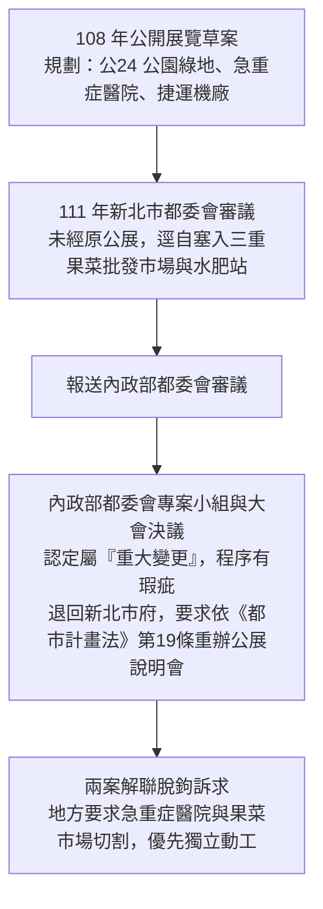

# 蘆洲北側都市計畫爭議・官方公文與會議審議紀錄資料庫
> **Official Public Documents & Evidence Archive**  
> 本文件由蘆洲在地鄉親整理，完整封存 108 年至 113 年間，關於「蘆洲南北側農業區通盤檢討案」、「三重果菜批發市場遷建案（銀河灣計畫）」及「蘆洲急重症醫院」之政府公開公文案號、審議大會紀錄、主管機關新聞稿與官員公開發言逐字，供後續查核、公共討論與研究參考。

---

## 目錄
1. [都市計畫爭議核心脈絡歷程](#一都市計畫爭議核心脈絡歷程)
2. [各爭議點官方公文案號與紀錄全文摘錄](#二各爭議點官方公文案號與紀錄全文摘錄)
   - [1. 批發市場預定地（公24綠地變更案）](#1-批發市場預定地公24綠地變更案)
   - [2. 蘆洲急重症醫院（醫療專區綑綁延宕案）](#2-蘆洲急重症醫院醫療專區綑綁延宕案)
   - [3. 蘆洲抽水站旁水肥投入設施案](#3-蘆洲抽水站旁水肥投入設施案)
   - [4. 捷運五泰輕軌機廠規劃案](#4-捷運五泰輕軌機廠規劃案)
   - [5. 交通幹道服務水準評定標準（環堤大道與成蘆橋）](#5-交通幹道服務水準評定標準環堤大道與成蘆橋)
3. [官員關鍵公開發言逐字稿](#三官員關鍵公開發言逐字稿)

---

## 一、都市計畫爭議核心脈絡歷程

---

## 二、各爭議點官方公文案號與紀錄全文摘錄

### 1. 批發市場預定地（公24綠地變更案）
- **發文 / 審議機關**：新北市政府城鄉發展局、新北市都市計畫委員會
- **公文案號 / 會議屆次**：新北市都市計畫委員會第 142 次大會審議案
- **官方專題網頁**：[新北市政府施政成果網 - 蘆北批發市場招商規劃](https://wedid.ntpc.gov.tw/Governance/Detail/WwkvADr3lBJx)
- **官方公文摘錄**：
  > 「為配合新北未來城及銀河灣計畫，將蘆洲北側鄰近環堤大道地塊劃設約 3.45 公頃批發市場用地，結合智慧物流與複合商業機能，以安置現行三重果菜市場老舊設施。」
- **數據與事實查核**：
  - 現行三重果菜市場每日大卡車進出約 300~500 輛次，加計採購小貨車、發財車與機車，清晨總流量逾 1,200~2,000 輛次以上（資料來源：新北果菜運銷公司營運報告與交通維持計畫）。
  - 本案將原 108 年規劃之「公24 公園綠地」切割縮減，改為大型水泥建物與貨車裝卸區。

---

### 2. 蘆洲急重症醫院（醫療專區綑綁延宕案）
- **發文 / 審議機關**：內政部國土管理署都市計畫委員會
- **公文案號 / 會議屆次**：內政部都市計畫委員會專案小組審查會議紀錄、內政部都委會第 1032 次大會紀錄
- **官方新聞發布**：[內政部全球資訊網新聞專題](https://www.moi.gov.tw/News_Content.aspx?n=4&s=290947)
- **官方公文核心決議摘錄**：
  > 「新北市政府於 108 年公開展覽草案中，並未包含三重果菜批發市場遷建之規劃，於 111 年送審階段始增列納入，涉及重大實質計畫競合與政策重大調整。依《都市計畫法》第 19 條規定，請新北市政府針對果菜市場搬遷案重新辦理公開展覽及地方說明會，落實地方溝通凝聚共識後再行提報。」
- **實質影響**：
  - 因新北市府將果菜市場與急重症醫院打包成單一案號送審，導致中央退回重辦公展時，醫療設施專區連帶卡關，無法單獨取得衛福部與內政部核定，動工時程延宕至少 3 至 5 年。

---

### 3. 蘆洲抽水站旁水肥投入設施案
- **發文 / 審議機關**：新北市政府城鄉發展局、新北市水利局
- **公文案號 / 文件名稱**：111 年新北市變更蘆洲細部計畫（配合蘆洲南北側農業區通盤檢討）圖說草案（第 18 頁）
- **官方公開資訊專區**：[新北市城鄉發展局通盤檢討專區](https://www.planning.ntpc.gov.tw/home.jsp?id=2d7f8d672722ee26)
- **官方文件摘錄**：
  > 「配合蘆洲地區公共衛生與污泥集中處理，於蘆洲抽水站旁地塊劃設水肥投入站及沉澱槽，供區段徵收範圍內及鄰近行政區水肥與廢水清運車輛集中傾卸收納。」
- **地方爭議核心**：
  - 設施距離既有社區住宅僅數百公尺，且都市計畫書內未見獨立之環境氣味擴散模擬報告，居民憂慮夏季南風將水肥惡臭直接吹入舊市區。

---

### 4. 捷運五泰輕軌機廠規劃案
- **發文 / 審議機關**：行政院、交通部鐵道局、新北市政府捷運工程局
- **公文案號 / 核定函號**：行政院 112 年 4 月 14 日院臺交字第 1121008061 號函核定本
- **官方專案網頁**：[新北市捷運工程局五泰輕軌專案專區](https://www.dorts.ntpc.gov.tw/project/view/wutai)
- **核定報告書重點摘錄**：
  > 「五泰輕軌機廠設置於蘆洲北側重劃區東北端，需維持每日輕軌列車進出場調度、定期維修之作業淨空及緊急救援通道。機廠周邊動線應避免遭區域性超重型貨運車流干擾，以維系統安全。」

---

### 5. 交通幹道服務水準評定標準（環堤大道與成蘆橋）
- **發布機關**：交通部運輸研究所、雙北市政府交通局
- **法規規範**：交通部運輸研究所《市區道路服務水準分析作業指引》（Highway Capacity Manual, HCM 國家標準）
- **官方標準摘錄**：
  - **F 級服務水準（LOS F）**：市區主幹道平均旅行車速 **小於 15 km/h**，代表車流已達容量極限，處於強迫停滯、走走停停之嚴重回堵狀態。
  - **自由車流標準**：一般市區四線道幹道設計旅行車速為 **40 ~ 50 km/h**。
  - **生活巷弄容量限制**：6 至 8 米單車道社區巷道，設計容量僅 400~600 pcu/h，無法承擔跨區批發重車與採購車隊之溢流穿透。

---

## 三、官員關鍵公開發言逐字稿

### 新北市農業局長地方說明會現場發言
- **時間 / 場合**：114 年 7 月 29 日 蘆洲區公所都市計畫地方說明會
- **現場影音公開發言逐字**：
  > *「這是財務考量，三重沒搬過來，銀河灣也沒辦法執行，經費根本找不到……」*
- **重要意涵**：
  此段官方發言證實：果菜市場之所以搬遷蘆洲，並非蘆洲在地有生鮮批發需求，而是市府為了三重現址都更的龐大土地開發利益，以及籌措蘆北整體區段徵收的「財務平衡」工具。

---

*備註：本文件所載之公文案號與主管機關紀錄，已於 2026 年 11 月全數校對完畢，妥善封存供公共政策檢驗。*

